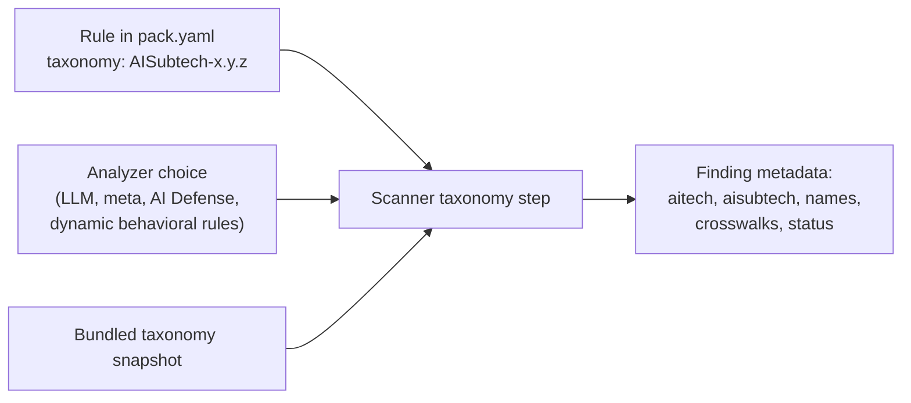

# Agent Skills Threat Taxonomy

> [!TIP]
> **TL;DR**
>
> Every finding carries a Cisco AI taxonomy technique (`AITech`), sub-technique (`AISubtech`) and the OWASP / MITRE ATLAS / NIST AML crosswalks for it. Codes come from a pinned snapshot of the Cisco AI Security and Safety Taxonomy 2.0.0 bundled with the scanner; rules select a code and the snapshot supplies the parent technique, names and crosswalks.

## Overview

Skill Scanner aligns threat labels to Cisco's AI Security Framework taxonomy.

- Authoritative taxonomy source: [Cisco AI Security Framework](https://learn-cloudsecurity.cisco.com/ai-security-framework)
- Public framework write-up: [Cisco AI Security Framework paper](https://arxiv.org/html/2512.12921v1)
- Bundled snapshot: [`skill_scanner/data/taxonomy/cisco_ai_taxonomy.json`](https://github.com/cisco-ai-defense/skill-scanner/blob/main/skill_scanner/data/taxonomy/cisco_ai_taxonomy.json), with its provenance in [`provenance.yaml`](https://github.com/cisco-ai-defense/skill-scanner/blob/main/skill_scanner/data/taxonomy/provenance.yaml)

The snapshot is a reduced copy of taxonomy version 2.0.0: objective, technique and sub-technique codes, their names, the parent/child structure, and each code's crosswalks. Definitions and labeling guidance are not shipped. `provenance.yaml` pins the source commit and the SHA-256 of both the source file and the snapshot; a test checks the shipped bytes against it. The snapshot is read once at import and never fetched or refreshed at runtime.

## Mapping Flow



Each rule selects one code. The scanner resolves it against the active taxonomy just before results are returned, for every finding (including suppressed and cross-skill findings), and in this order:

1. **Analyzer choice.** Analyzers that classify each finding themselves (LLM, meta, AI Defense, and the behavioral `BEHAVIOR_ALIGNMENT_*` / `BEHAVIOR_CROSSFILE_*` rules) put `aitech` / `aisubtech` on the finding. A sub-technique implies its parent technique; a sub-technique that does not belong to the chosen technique is dropped.
2. **Threat-mapping override.** A custom `--threat-mapping` file that sets `aitech` / `aisubtech` for a threat applies that code to findings of the matching analyzer and category (`yara_threats` covers the static analyzer). This is how an organization remaps bundled rules onto its own taxonomy.
3. **Rule declaration.** The rule's `taxonomy` in its pack manifest.
4. **Pack default.** The pack's `taxonomy_defaults` entry for the rule's category.

A code that does not exist in the active taxonomy is never emitted; the finding is reported as `unmapped` instead.

## Finding Fields

| Field | Meaning |
|---|---|
| `aitech`, `aitech_name` | Technique code and official name |
| `aisubtech`, `aisubtech_name` | Sub-technique code and name; `null` when the selection is a technique the taxonomy gives no fitting sub-technique for (for example `AITech-1.2`, which has none) |
| `aitech_mappings` | Crosswalks listed for the technique |
| `aisubtech_mappings` | Crosswalks listed for the sub-technique |
| `framework_mappings` | The most specific of the two: the sub-technique's crosswalks when one is selected, otherwise the technique's |
| `taxonomy_status` | `mapped`, `not_applicable` (operational findings such as `LLM_ANALYSIS_FAILED` that describe no attack technique), or `unmapped` |
| `taxonomy_source` | `finding`, `threat_mapping`, `rule`, or `pack_default` |

The crosswalk lists differ by level. For example `AITech-9.1` lists 13 crosswalks for the whole technique family, while `AISubtech-9.1.4` (injection attacks) lists 10, so consumers that want one list should read `framework_mappings`.

SARIF results carry `aitech`, `aisubtech` and the crosswalk lists in `properties`. Each scan result's `scan_metadata.taxonomy` records the taxonomy version, source commit, snapshot hash, and how many findings were mapped, not applicable, or unmapped. With a custom taxonomy it reports `source: custom` and the file's SHA-256, never its path.

## Declaring Taxonomy in Rule Packs

```yaml
taxonomy_defaults:              # optional, by threat category
  data_exfiltration: AISubtech-8.2.3
rules:
  DATA_EXFIL_ENV_DUMP:
    source: signature
    category: data_exfiltration
    taxonomy: AISubtech-14.1.1  # overrides the category default
    severity: HIGH
```

`taxonomy` accepts an `AISubtech-*` code (preferred), an `AITech-*` code when no sub-technique fits, `not_applicable`, or `per_finding` (the analyzer chooses per finding). Bundled packs must give every rule a selection and are checked against the bundled snapshot when they load. Trusted local packs may declare one, and are checked only for shape so they can target a custom taxonomy.

## Typical Mappings

The table lists the codes most core rules use; the exact selection for every rule is in its pack manifest.

| Scanner Threat | AITech | AISubtech | Notes |
|---|---|---|---|
| Prompt Injection | `AITech-1.1` | `AISubtech-1.1.1` | Instruction override in prompts/instructions |
| Jailbreak | `AITech-1.1` | `AISubtech-1.1.5` | Persona, role-play and false-premise framing |
| Hidden or encoded instructions | `AITech-1.1` | `AISubtech-1.1.2` | Unicode smuggling, hidden HTML, encoded payloads |
| Transitive Trust Abuse | `AITech-1.2` | — | Indirect prompt injection from external content; the taxonomy defines no sub-technique |
| Autonomy Abuse | `AITech-2.1` | `AISubtech-2.1.1` | Acting without the required approval |
| Undeclared capability use | `AITech-2.1` | `AISubtech-2.1.2` | Tool use beyond `allowed-tools` or the declared behavior |
| Skill Discovery Abuse | `AITech-4.3` | `AISubtech-4.3.5` | Capability inflation, over-broad triggers |
| Data Exfiltration | `AITech-8.2` | `AISubtech-8.2.3` | Exfiltration via agent tooling |
| System prompt extraction | `AITech-8.4` | `AISubtech-8.4.1` | Requests to reveal system instructions |
| Command Injection | `AITech-9.1` | `AISubtech-9.1.4` | SQL/command/script injection patterns |
| Code Execution | `AITech-9.1` | `AISubtech-9.1.1` | Unsafe execution primitives, fetch-and-execute |
| Obfuscation | `AITech-9.2` | `AISubtech-9.2.1` | Encoded blobs, opaque binaries, bytecode without source |
| Supply Chain Attack | `AITech-9.3` | `AISubtech-9.3.1` / `9.3.3` | Malicious packages; unpinned dependencies |
| Hardcoded Secrets / credential access | `AITech-14.1` | `AISubtech-14.1.1` | Embedded or harvested credentials |
| Resource Abuse | `AITech-13.1` | `AISubtech-13.1.1` | Compute exhaustion and availability abuse |
| Malware | `AITech-15.1` | `AISubtech-15.1.1` | Malware, droppers, C2 persistence |

## Where Mappings Live

- Rule selections: each pack's `pack.yaml` under [`skill_scanner/data/packs/`](https://github.com/cisco-ai-defense/skill-scanner/tree/main/skill_scanner/data/packs)
- Taxonomy loader and helpers: [`skill_scanner/threats/cisco_ai_taxonomy.py`](https://github.com/cisco-ai-defense/skill-scanner/blob/main/skill_scanner/threats/cisco_ai_taxonomy.py)
- Finding annotation: [`skill_scanner/core/finding_taxonomy.py`](https://github.com/cisco-ai-defense/skill-scanner/blob/main/skill_scanner/core/finding_taxonomy.py)
- Analyzer threat labels: [`skill_scanner/threats/threats.py`](https://github.com/cisco-ai-defense/skill-scanner/blob/main/skill_scanner/threats/threats.py)
- Tests: [`tests/test_taxonomy_snapshot.py`](https://github.com/cisco-ai-defense/skill-scanner/blob/main/tests/test_taxonomy_snapshot.py), [`tests/test_finding_taxonomy.py`](https://github.com/cisco-ai-defense/skill-scanner/blob/main/tests/test_finding_taxonomy.py), [`tests/test_taxonomy_validation.py`](https://github.com/cisco-ai-defense/skill-scanner/blob/main/tests/test_taxonomy_validation.py)

## Custom Taxonomy Support

Skill Scanner can load a custom taxonomy profile at runtime.

Set:

```bash
export SKILL_SCANNER_TAXONOMY_PATH=/path/to/taxonomy.json
```

Supported taxonomy file formats:

1. Full framework format (the `OB-* -> ai_tech -> ai_subtech` JSON shape).
2. Flattened format:

```json
{
  "AITECH_TAXONOMY": {
    "AITech-1.1": "Direct Prompt Injection"
  },
  "AISUBTECH_TAXONOMY": {
    "AISubtech-1.1.1": "Instruction Manipulation (Direct Prompt Injection)"
  }
}
```

Optional flattened mapping keys:
- `AITECH_FRAMEWORK_MAPPINGS`
- `AISUBTECH_FRAMEWORK_MAPPINGS`
- `AISUBTECH_PARENTS` (sub-technique -> technique)

The mapping keys store cross-framework links (OWASP, MITRE ATLAS/ATT&CK, NIST AML, Cisco MDL) as string arrays by code. Without `AISUBTECH_PARENTS`, a sub-technique belongs to the technique its number is nested under (`AISubtech-1.1.1` -> `AITech-1.1`) when that technique is in the file; otherwise it has no parent and findings that select it are reported as `unmapped`.

### CLI Overrides

For one-off runs, prefer CLI flags over environment variables:

```bash
skill-scanner scan /path/to/skill \
  --taxonomy /path/to/taxonomy.json \
  --threat-mapping /path/to/threat_mapping.json
```

`--taxonomy` accepts JSON or YAML.
`--threat-mapping` accepts JSON.

If you also need custom scanner threat mappings, set:

```bash
export SKILL_SCANNER_THREAT_MAPPING_PATH=/path/to/threat_mapping.json
```

`SKILL_SCANNER_THREAT_MAPPING_PATH` supports these top-level keys:
- `llm_threats`
- `yara_threats`
- `behavioral_threats`
- `aitech_to_category`

Each `*_threats` value is merged by threat name and can override `aitech`, `aisubtech`, `severity`, or labels. An `aitech` / `aisubtech` override is applied to findings (see [Mapping Flow](#mapping-flow)); a code the active taxonomy does not contain is ignored.

## Cross-Framework Mapping Access

Skill Scanner now exposes framework mapping helpers from `skill_scanner.threats`:

- `get_aitech_framework_mappings(code)`
- `get_aisubtech_framework_mappings(code)`
- `get_framework_mappings(aitech_code=..., aisubtech_code=...)`

At the threat level, use:

- `ThreatMapping.get_framework_mappings_for_threat(analyzer, threat_name)`

The bundled snapshot includes crosswalks for every technique and sub-technique. A custom taxonomy provides them through `mappings` in the `OB-*` shape or the flattened `*_FRAMEWORK_MAPPINGS` fields.

## Updating the Snapshot

1. Regenerate the snapshot from the taxonomy release, pinning its commit and hash:
   ```bash
   python scripts/update_taxonomy_snapshot.py /path/to/taxonomy.json \
     --revision <taxonomy repository commit> --expect-sha256 <sha256 of taxonomy.json>
   ```
2. Load the packs (`uv run pytest tests/test_finding_taxonomy.py -q`). Any rule whose code no longer exists fails to load; give it a new `taxonomy` selection.
3. Run the taxonomy tests:
   - `uv run pytest tests/test_taxonomy_snapshot.py tests/test_taxonomy_validation.py tests/test_threats.py -q`
4. Refresh this document if typical mappings change.

## Notes

- Taxonomy 2.0.0 changed several codes the scanner used before: jailbreaks moved into `AITech-1.1` (`AITech-2.1` is now Excessive Agency), `AITech-1.2` has no sub-techniques, and multimodal injection moved to `AITech-1.3`.
- The scanner no longer emits the `AITech-99.9` / `AISubtech-99.9.9` placeholders. A finding without a real code is `unmapped`.
- **ASCII Smuggling** maps to `AISubtech-1.1.2` (Obfuscation of a prompt-injection payload): printable ASCII is mapped to Unicode Tag Block characters (U+E0000–U+E007F), invisible in editors and terminals but decoded by LLMs. Even a single Tag Block character in a skill file is considered CRITICAL. See: [Scary Agent Skills](https://embracethered.com/blog/posts/2026/scary-agent-skills/) and [aid detection tool](https://github.com/wunderwuzzi23/aid). Detected by rule `ASCII_SMUGGLING_TAG_BLOCK` and YARA pattern `$tag_block` in `prompt_injection_unicode_steganography.yara`.

## Related Pages

- [Writing Custom Rules](analyzers/writing-custom-rules.md) -- Author rules that use threat categories
- [Scanning Pipeline](scanning-pipeline.md) -- How findings flow through the system
- [Custom Policy Configuration](../user-guide/custom-policy-configuration.md) -- Override severity and disable rules by threat type
